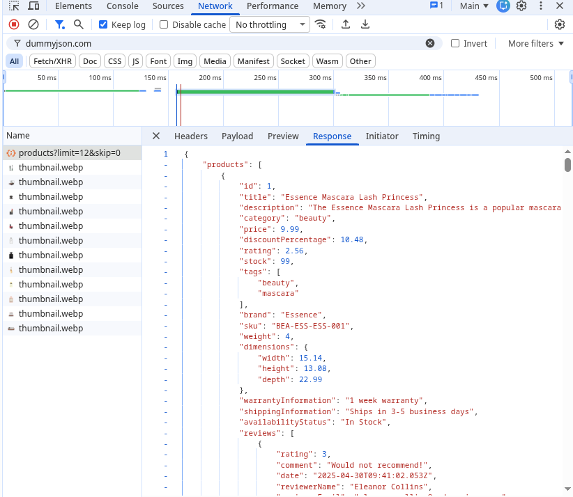
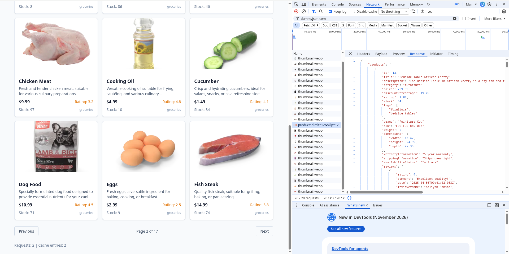
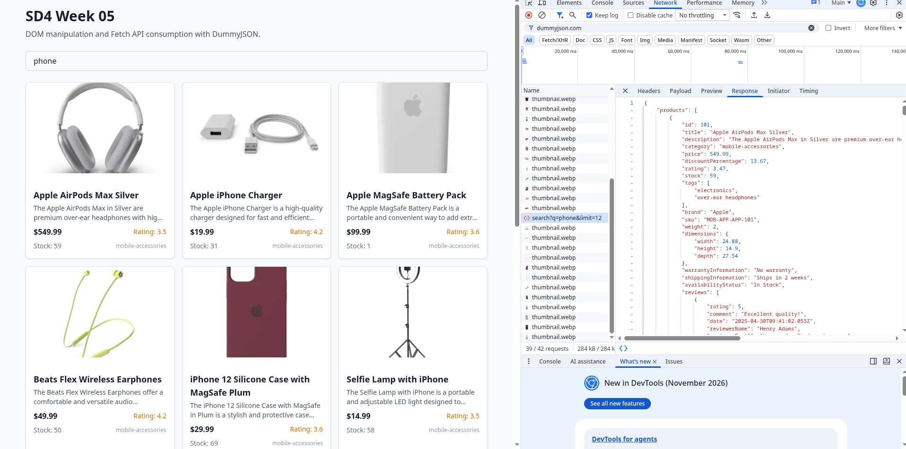
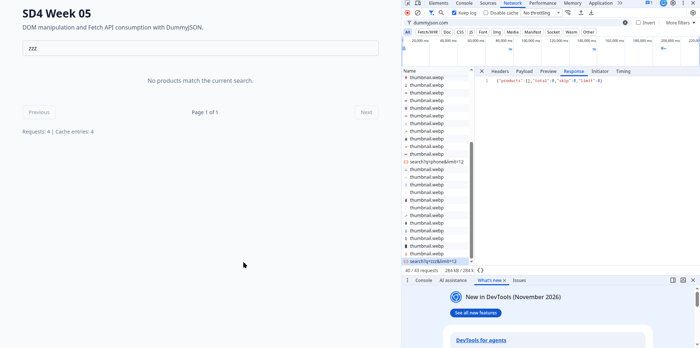

# Week 05 - DOM Manipulation and Fetch API

## 1. Introduction

This document explains the architecture and implementation of the Week 05 laboratory project for Software Development IV at Jala University. The project is a single-page application built with HTML5, CSS3, and vanilla JavaScript (ES Modules) that consumes the public DummyJSON API to display a list of products with pagination and search capabilities.

The main technical goals of the project are:

- Consuming a public REST API using the browser `Fetch` API.
- Rendering data dynamically by manipulating the DOM.
- Demonstrating intentional use of **closures** and **Promises** as required by the evaluation rubric.
- Providing a reproducible testing strategy with unit tests (Vitest + jsdom) and end-to-end tests (Playwright).
- Automating quality checks and deployment through GitHub Actions and GitLab CI.

## 2. Project Overview

| Area                   | Technology                                                                     |
| ---------------------- | ------------------------------------------------------------------------------ |
| Language               | JavaScript (ES Modules) with JSDoc annotations                                 |
| Styling                | Tailwind CSS (CLI build)                                                       |
| Bundler                | Vite                                                                           |
| Unit testing           | Vitest with jsdom                                                              |
| End-to-end testing     | Playwright (Chromium)                                                          |
| Type checking          | TypeScript `tsc --checkJs` over JSDoc                                          |
| Linting and formatting | ESLint + Prettier                                                              |
| Containerization       | Docker multi-stage + Docker Compose                                            |
| CI/CD                  | GitHub Actions and GitLab CI, with deployment to GitHub Pages and GitLab Pages |

The final application is deployed and available at two mirrored URLs:

- GitHub Pages: `https://jalau-labs.github.io/sd4-week05-dom-fetch/`
- GitLab Pages: `https://sd4-week05-dom-fetch-28261b.gitlab.io/`

## 3. Architecture

The source tree is organized around small, cohesive modules, each of which owns a single responsibility:

```
src/
├── api/
│   ├── errors.js       Typed ApiError class
│   ├── http.js         Fetch wrapper with timeout and abort
│   └── products.js     Products client (closure factory)
├── components/
│   ├── productCard.js  Card element for one product
│   ├── productGrid.js  Grid with loading, error, empty and list states
│   └── searchBar.js    Debounced search input
├── utils/
│   └── dom.js          DOM helpers
└── main.js             Application bootstrap
```

The API layer is completely decoupled from the presentation layer. `main.js` orchestrates both and keeps the view-level state (current query, current page) inside a closure, so that no global variables leak into the page.

## 4. Consuming the DummyJSON API with Fetch

DummyJSON exposes standard REST endpoints:

- `GET /products?limit={n}&skip={m}` for pagination.
- `GET /products/{id}` for a single product.
- `GET /products/search?q={query}&limit={n}` for full-text search.

Each request is issued through the `getJson` helper defined in `src/api/http.js`. This wrapper adds three properties that `fetch` alone does not provide:

1. A **timeout** that aborts the request if it exceeds the configured threshold.
2. A **caller-provided AbortSignal** that is bridged with the internal controller, so both the caller and the timeout can abort the same request.
3. Consistent **error mapping** to the `ApiError` class with machine-readable codes (`NETWORK_ERROR`, `HTTP_ERROR`, `PARSE_ERROR`, `ABORTED`, `TIMEOUT`, `INVALID_ARGUMENT`).

## 5. Closures in Practice

A closure is created when a function captures variables from its lexical scope and keeps them alive beyond the lifetime of the function call that created them. In this project, closures are the primary mechanism for state encapsulation.

### 5.1 The products client as a closure factory

`src/api/products.js` exports a factory, `createProductsClient`, that returns an object whose methods close over five private bindings:

```javascript
export function createProductsClient(config = {}) {
  const cache = new Map();
  const inFlight = new Map();
  const listeners = new Set();
  let requestCount = 0;

  function notify(event) {
    /* ... */
  }
  function subscribe(listener) {
    /* ... */
  }
  async function getCached(url, cacheKey) {
    /* ... */
  }
  // ...
  return { listProducts, getProduct, searchProducts, abortPending, subscribe, getStats };
}
```

None of those bindings is reachable from the outside. `getStats()` is the only sanctioned way to inspect them, and it does so by returning a snapshot. Two instances created by two separate calls to `createProductsClient()` never share state, which the unit test `keeps independent state per client instance` verifies.

The closure also gives us **per-instance caching**: since `cache` belongs to the instance, a test can create a client pointed at `https://a.test` and another at `https://b.test`, and their caches never collide.

### 5.2 Debounce in the search bar

`src/components/searchBar.js` implements debouncing without any external library, using a closure over a single timer identifier:

```javascript
export function createSearchBar({ onSearch, debounceMs = 300 }) {
  let timerId;

  input.addEventListener("input", () => {
    if (timerId !== undefined) {
      clearTimeout(timerId);
    }
    const value = input.value;
    timerId = window.setTimeout(() => {
      timerId = undefined;
      onSearch(value.trim());
    }, debounceMs);
  });

  return { element, getValue, clear };
}
```

The `timerId` binding is captured by the `input` event listener. Every keystroke cancels the previous timer and schedules a new one, so the callback fires only after the user has paused for `debounceMs` milliseconds. Without closures, `timerId` would have to be a module-level global, which would break if two search bars existed on the same page. The unit test `debounces onSearch calls` uses fake timers to verify that intermediate keystrokes do not trigger the callback.

### 5.3 The subscription mechanism

`subscribe(listener)` returns an unsubscribe function:

```javascript
function subscribe(listener) {
  listeners.add(listener);
  return () => {
    listeners.delete(listener);
  };
}
```

The returned arrow function closes over the exact `listener` reference that was added. The caller can therefore remove a specific listener without needing to remember it, and even if several listeners are registered, only the intended one is removed. The test `unsubscribe stops delivering events` asserts this invariant by counting callbacks before and after unsubscription.

## 6. Promises in Practice

Every asynchronous operation in the project returns a native Promise. Promises are not only syntactic conveniences here: they are the mechanism that lets the UI show a loading state, handle errors uniformly, and deduplicate concurrent requests.

### 6.1 Async/await over Promise chains

All internal request functions are declared `async`, which makes them return Promises automatically. Callers use `await`, and each `try/catch` block converts any rejection into a UI state:

```javascript
async function load() {
  grid.renderLoading();

  try {
    const response =
      state.query.length > 0
        ? await client.searchProducts(state.query, { limit: PAGE_SIZE })
        : await client.listProducts({ limit: PAGE_SIZE, skip: (state.page - 1) * PAGE_SIZE });

    state.totalPages = Math.max(1, Math.ceil(response.total / PAGE_SIZE));
    grid.render(response.products);
    renderPagination();
    renderStatus();
  } catch (error) {
    if (isApiError(error)) {
      grid.renderError(`Could not load products: ${error.code}`);
    } else {
      grid.renderError("Unexpected error while loading products.");
    }
  }
}
```

The `isApiError` type guard narrows the caught value from `unknown` to `ApiError`, which lets us read `error.code` safely and translate it to a meaningful user message.

### 6.2 Typed errors

`src/api/errors.js` defines `ApiError`, which extends `Error` and carries a `code` field with a finite union of string literals:

```javascript
export class ApiError extends Error {
  constructor(message, { status, code, cause }) {
    super(message);
    this.name = "ApiError";
    this.status = status;
    this.code = code;
    this.cause = cause;
  }
}
```

Because `code` is one of `NETWORK_ERROR`, `HTTP_ERROR`, `PARSE_ERROR`, `ABORTED`, `TIMEOUT` or `INVALID_ARGUMENT`, JSDoc-aware tooling (including `tsc --checkJs`) validates every branch that switches on it, and the presentation layer can render a stable, user-facing message without inspecting raw `Response` objects.

### 6.3 Timeout and abort

Inside `getJson`, a `setTimeout` aborts the request after `timeoutMs` milliseconds. The wrapper also bridges any caller-provided `AbortSignal` with its internal controller:

```javascript
const controller = new AbortController();
const timeoutId = setTimeout(() => controller.abort("timeout"), timeoutMs);

const onCallerAbort = () => controller.abort(signal?.reason);
if (signal) {
  if (signal.aborted) {
    onCallerAbort();
  } else {
    signal.addEventListener("abort", onCallerAbort, { once: true });
  }
}
```

When `fetch` rejects, `isAbortReason` distinguishes between caller-initiated cancellation and timeout so the resulting `ApiError.code` is precise. The test `aborts with TIMEOUT when the timeout elapses` uses fake timers to verify the timeout path deterministically.

### 6.4 Cache and in-flight deduplication

The `getCached` helper is a Promise-aware function that combines two optimizations:

1. **Memoization**: on a cache hit, the Promise resolves immediately with the cached value.
2. **In-flight deduplication**: if the same URL is requested twice before the first response arrives, the second call aborts the first controller and takes over, so only one network request ultimately completes.

Because both operations are expressed through Promises, the caller does not need to distinguish cache hits from network responses. The end-to-end test `serves visited pages from cache without new requests` confirms this behavior at the network level: after visiting page 2 and returning to page 1, the request counter remains unchanged.

## 7. DOM Manipulation

DOM manipulation is centralized in `src/utils/dom.js` (element creation, child clearing, price and rating formatting) and in the component factories. Each component exposes a small set of methods that map to UI states:

- `productGrid.render(products)`
- `productGrid.renderLoading()`
- `productGrid.renderError(message)`
- `productGrid.renderEmpty()`

This makes the state machine explicit: `main.js` always transitions through one of those methods, and no component ever queries the DOM for elements it did not create itself. The unit tests exercise each state individually and assert the resulting content and element count.

## 8. Testing Strategy

The project applies a two-layer testing pyramid.

**Unit tests (Vitest + jsdom):** 28 tests across six files. They mock `fetch` at the module boundary and verify caching, error mapping, subscription lifecycle, DOM rendering, and debounce behavior without launching a browser.

**End-to-end tests (Playwright + Chromium):** 5 tests. They intercept DummyJSON requests with `page.route()` and serve deterministic fixtures, which makes the suite independent of the live API, removes flakiness, and lets the tests assert the request counter exposed by the application (evidence of caching). The suite runs against the production build, not the dev server, so the artifact that reaches Pages is the one being tested.

Coverage of `src/` is above 98 % for statements and 88 % for branches as of the latest run.

## 9. Deployment

Both pipelines execute the same logical stages:

1. **Verify:** install with `--frozen-lockfile`, lint, format check, type check, unit tests, production build.
2. **End-to-end:** install Playwright, run E2E against `vite preview`.
3. **Deploy:** publish `dist/` to Pages.

GitHub Actions caches Playwright browsers between runs. GitLab CI caches the pnpm store. Both pipelines use Node 20 and pnpm 12.16.1, pinned through the `packageManager` field in `package.json`.

The production bundle is also available as a Docker image (`sd4-week05-dom-fetch:local`) built from a multi-stage Dockerfile and served by Nginx with a hardened configuration: CSP, `X-Content-Type-Options`, `X-Frame-Options`, `Referrer-Policy`, gzip, and one-year caching for hashed assets.

## 10. Browser Developer Tools Evidence

The following sections document the network behavior of the deployed application using the browser's built-in Developer Tools. To reproduce them, open the deployed URL in any Chromium-based browser and open DevTools with `F12` or `Ctrl+Shift+I`, then switch to the **Network** tab.

For every screenshot, the filter should be set to `dummyjson.com` so that only the relevant API requests appear. The columns to keep visible are `Name`, `Status`, `Type`, `Size`, and `Time`. Right-clicking any row and choosing **Copy → Copy as cURL** is a valid way to capture the exact request, but screenshots are the required evidence for this laboratory.

### 10.1 Initial page load



**What to observe:** exactly one request to `https://dummyjson.com/products?limit=12&skip=0` with status 200. The Response tab shows a JSON payload with `total`, `skip`, `limit`, and an array of twelve products. The application displays "Requests: 1 | Cache entries: 1" in the footer.

### 10.2 Pagination



**What to observe:** clicking the "Next" button triggers a second request to `https://dummyjson.com/products?limit=12&skip=12`. The footer updates to "Requests: 2 | Cache entries: 2". Navigating back to page 1 does not produce a third request because the first page is served from the in-memory cache; this is the cache-hit behavior implemented in `getCached`.

### 10.3 Search



**What to observe:** typing a query into the search box produces exactly one request to `https://dummyjson.com/products/search?q={query}&limit=12`, triggered after the 300 ms debounce window. Typing additional characters within the window cancels the previous timer, so only the final query reaches the network. The Response tab shows the filtered product array.

### 10.4 Empty state



**What to observe:** a query with no matches returns a payload where `products` is an empty array and `total` is `0`. The grid switches to the empty-state message "No products match the current search." without rendering any cards.

## 11. Conclusion

The laboratory exercise demonstrates that vanilla JavaScript, combined with a clear module decomposition, is sufficient to build a small but complete application that:

- Consumes a public API using `Fetch` and Promises.
- Encapsulates state using closures, avoiding global leakage and enabling isolated unit tests.
- Renders UI states through explicit component methods.
- Is covered by unit and end-to-end tests that run in CI on every push.
- Is deployed to two independent hosting platforms and to a container image.

The separation between the API layer (`src/api/`), the presentation layer (`src/components/`), and the orchestration layer (`src/main.js`) is the structural decision that makes each piece testable in isolation. The rubric-required concepts of closures and Promises are not decoration: they are load-bearing.
